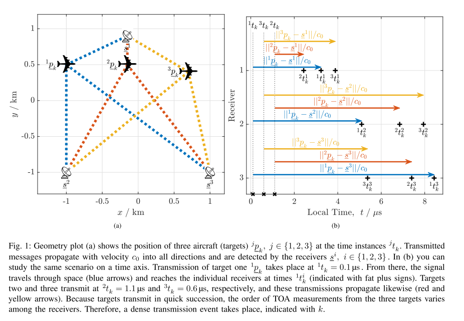
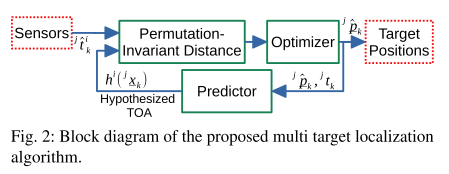
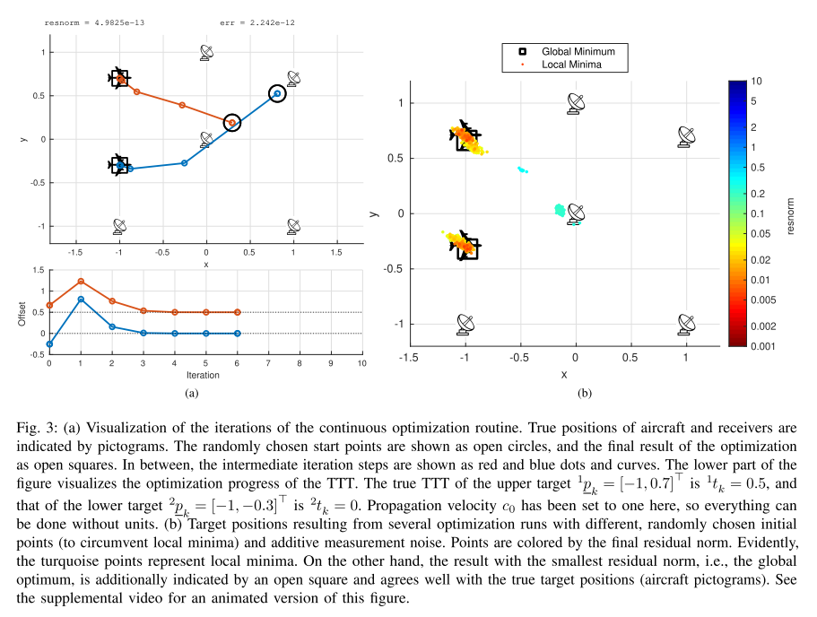
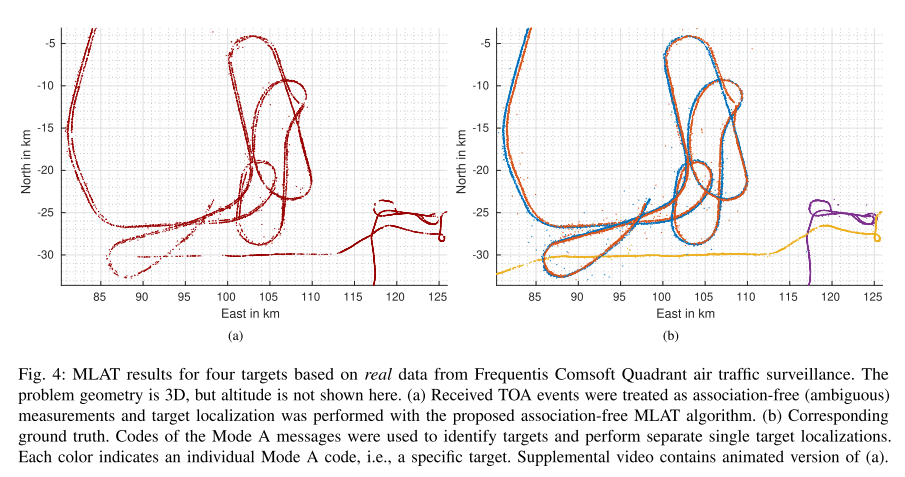

# [TOA]Unrelated Multi-Resolution Based on Arrival Time[with MATLAB Code]

Introduction: Electromagnetic and acoustic signals possess various attributes that can be utilized to obtain the location of the signal emitter (target) when received at multiple locations. In Multi-Locator Aided Tracking (MLAT), Time of Arrival (TOA) is used for target positioning. A typical example is in aircraft surveillance, where each aircraft's transmitter emits what is known as Mode A/C signals. Due to this standard only allowing 4096 addresses, it is common for multiple aircraft to have the same address within an airspace. The Mode A/C transmission is triggered by the interrogating station, hence many targets often emitting shortly after each other is common. Therefore, receivers are typically unable to separate targets solely based on TOA time distance. Other application scenarios for the proposed method include tracking objects emitting unidentifiable acoustic events.
Latest Technology: Signal attributes carrying information about their transmitter's location, such as Received Signal Strength (RSS) [2] and Angle of Arrival (AOA), also known as Azimuth Measurement [3], [4] are utilized. For receiver networks with precise time synchronization, TOA measurement [5], [6] or differences thereof [7], [8], [9] can be used to obtain the most accurate position estimates. This is commonly referred to as MLAT. In Secondary Surveillance Radar (SSR), the signal transmission is actively triggered by a detector, providing additional indication of the target distance between sending the inquiry and receiving the target response duration [10]. However, caution should be exercised when using this information if the target processing the inquiry requires a time delay that is not accurately determined. Two common SSR variants are Mode S and Mode A/C.
For multi-object tracking, the primary challenge is that the association between measurements and targets is unknown. If the association is known because of transmissions containing separate codes, the problem can be simplified to single-target tracking, targeting each target separately. Multi-object tracking can be addressed using a joint probability data association filter [11], but this requires enumerating all possible association hypotheses. Other methods, such as the Probability Hypothesis Density Filter, avoid measuring the association in their formulas [12] and [13]. Other interesting possibilities include symmetric and invariant transformations, such as SME filters [14], kernel SME filters [15], [16], or methods based on invariant set distance metrics [17], [18]. However, most methods have been proposed for linear measurement models or only with full-dimensional measurements, and cannot easily be applied to nonlinear subspace measurements, such as TOA for transmitter positioning.
Contribution: This paper considers a multi-object localization system with real TOA measurement values, including a nonlinear measurement model. In this model, the TOA measurement value is a nonlinear function, which is a nonlinear function. Our method can be used to instantaneously locate multiple objects that send the same message without any prior knowledge.
Article illustration
Conclusion: We propose an effective algorithm MLAT, which does not require the association between receiving events and tracking targets. Synthetic and real data evaluation shows that fuzzy TOA measurements have good localization accuracy.
Typically, receiving events include scalar (TOA) measurements. For scalar measurements, this method is particularly fast and effective, requiring only a classification program to find the optimal arrangement. Moreover, optimal arrangements can be obtained independently for each receiver, reducing overall complexity and promoting parallel execution.

## Images

<!-- PAYMENT_BLOCK -->

## Get this dataset

- Payment link (Stripe): [Buy now](https://buy.stripe.com/3cs8yP7sY87d0vu9AB)
- Payment QR code: 

<!-- /PAYMENT_BLOCK -->
